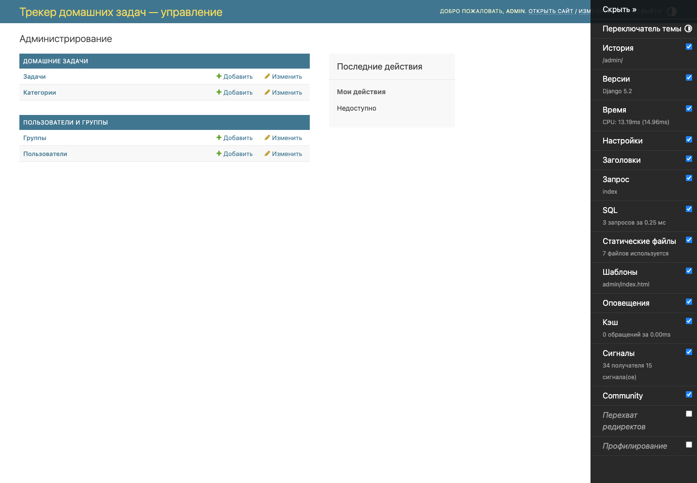
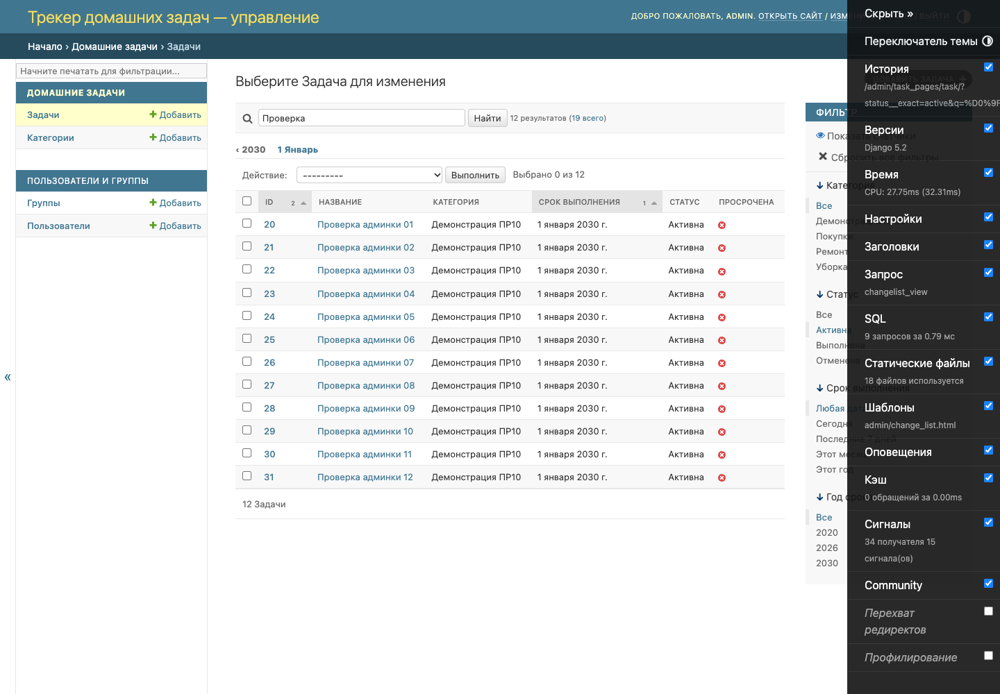
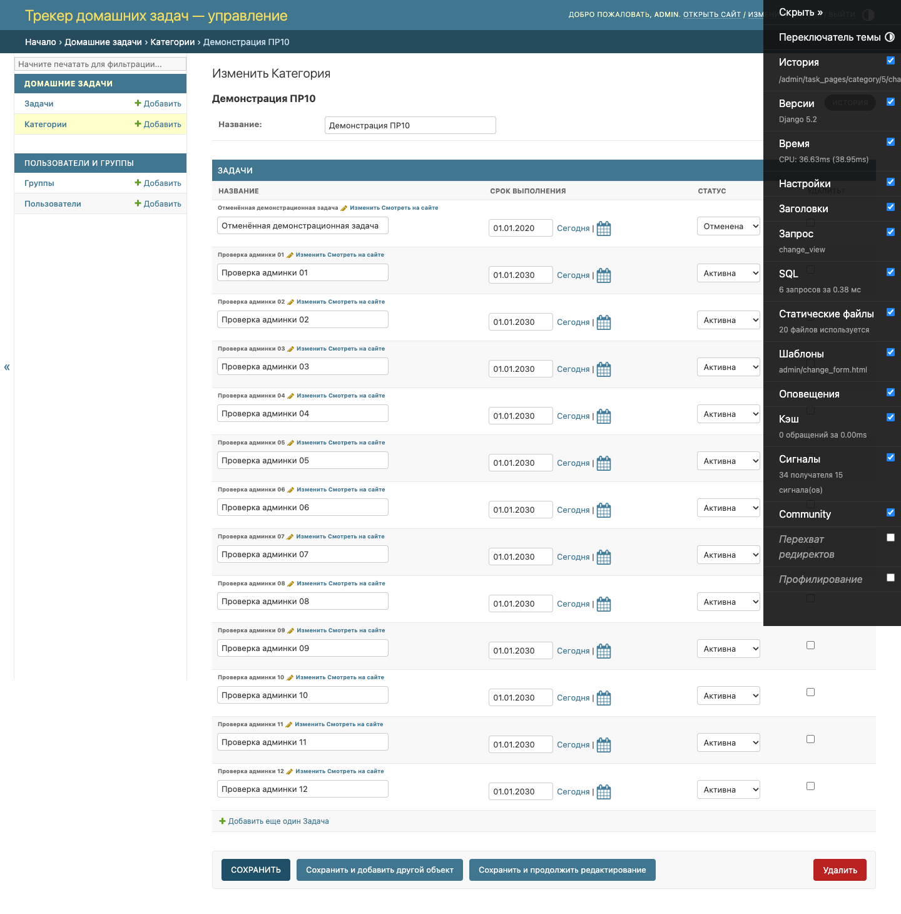
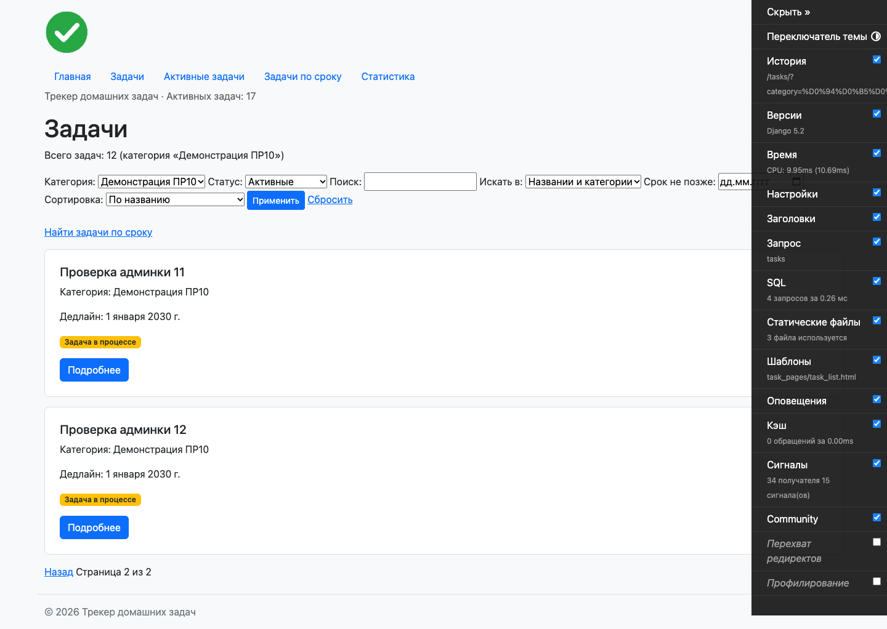
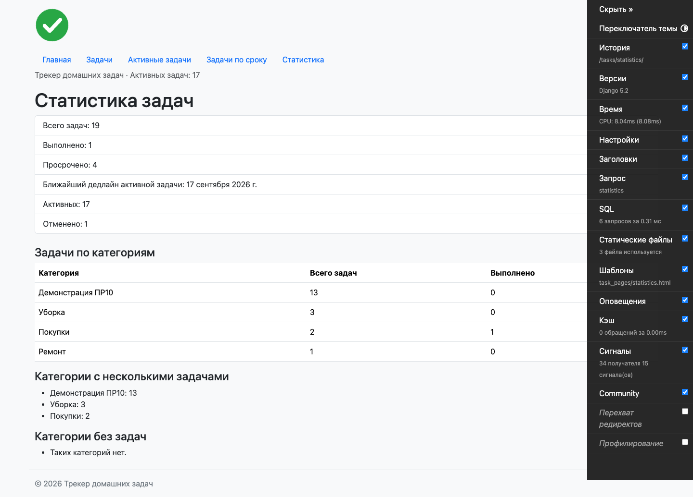
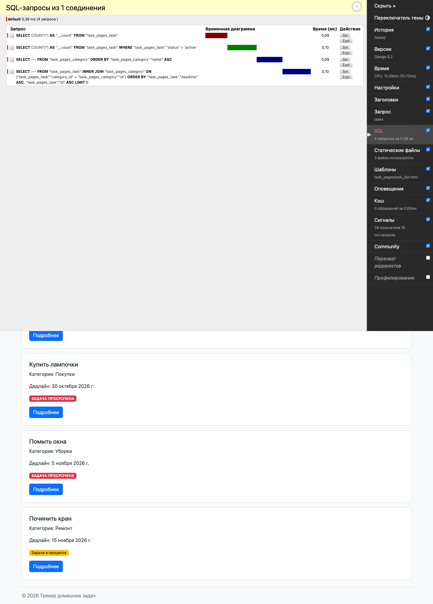

# Отчёт по практической работе № 10

| Поле | Значение |
|---|---|
| Образовательная организация | Указать перед сдачей |
| Дисциплина | Технологии разработки приложений на базе фреймворков |
| Тема | Административная панель Django и работа с данными через ORM |
| Группа | ЭФБО-06-24 |
| Студент | Казанцев Егор |
| Вариант | Трекер домашних задач; номер варианта указать перед сдачей |
| Дата | 10.11.2026 |

## 1. Цель работы

Настроить административную панель существующего проекта, углубить навыки Django ORM, развить модель задачи и проверить корректность и количество SQL-запросов. Примеры Roomly из методички адаптированы к категориям и домашним задачам.

## 2. Материалы Яндекс Практикума

К текущему этапу относятся блоки «Админ-зона Django», «Django ORM. Получение информации из БД», «Финальный проект спринта: публикации для Блогикум». Прохождение заданий курса не проверялось; студенту необходимо подтвердить фактически выполненные материалы перед сдачей.

## 3. Настройка административной панели

Модели Category и Task зарегистрированы по адресу /admin/. Настроены русские названия сайта, приложения, моделей и полей. Список задач содержит ID, название, категорию, срок, статус и вычисляемый признак просрочки. Добавлены поиск по названию и категории, фильтры статуса, категории, даты и года, сортировка, иерархия дат и пагинация по 20 записей. В карточке задачи поля сгруппированы; slug и вычисляемый год доступны только для чтения.

TaskInline позволяет редактировать связанные задачи внутри категории. Число задач категории вычисляется через annotate(Count), а список задач загружает категории через select_related. Создан локальный суперпользователь; его реквизиты и локальная база исключены из Git. Проверены вход, списки, поиск, фильтры, встроенные формы и запрет доступа обычному пользователю.

## 4. Модели, миграции и QuerySet

Поле is_completed заменено на status с TextChoices: ACTIVE («Активна»), COMPLETED («Выполнена»), CANCELLED («Отменена»). Миграция 0002_task_status_slug_year сначала добавляет поля, переносит False в active и True в completed, заполняет уникальные slug, затем удаляет булево поле. Все 6 исходных задач и их связи сохранены: 5 активных, 1 выполненная. Перед работой сделана резервная копия базы. Обратная миграция проверена; отменённые при откате становятся невыполненными, поскольку булево поле не представляет третий статус.

TaskQuerySet предоставляет методы active(), completed(), cancelled(), overdue(), due_by(day), with_category(). Они используются в представлениях. Отменённые задачи исключаются из активных, просроченных и поиска по сроку; статистика считает все три статуса. Это адаптация требования об исключении отменённых бронирований к предметной области трекера: поиска свободных помещений здесь нет.

Для карточки добавлен адрес /tasks/by-slug/<slug>/ и get_absolute_url(); старые адреса по ID сохранены. Slug новых задач состоит из ASCII-префикса и UUID и не меняется при переименовании. GeneratedField вычисляет год срока на стороне SQLite. Контекстный процессор передаёт название сайта и ленивый счётчик активных задач в навигацию.

## 5. ORM и анализ SQL

Сохранена совместная работа фильтров, поиска через Q, сортировки и пагинации. Проверены get, filter, exclude, связанные выборки, annotate, aggregate, Count, Min и план выполнения explain(). Для воспроизведения анализа добавлена команда python manage.py analyze_orm.

Django Debug Toolbar 6.2.0 подключена для локального режима DEBUG, отключена при тестировании. В реальном Chrome SQL-панель показала 4 запроса для анонимного /tasks/: количество задач для пагинации, число активных для навигации, список категорий и задачи с JOIN. На 6 исходных задачах чтение названий категорий без select_related потребовало 7 запросов, с select_related — 1. Оптимизация списка существовала в ПР9; ПР10 подтверждает её работу и отсутствие N+1.

## 6. Результаты проверки

- python manage.py check — замечаний нет.
- python manage.py makemigrations --check --dry-run — изменений нет.
- python manage.py showmigrations — миграции 0001 и 0002 применены.
- pytest -v — 67 тестов прошли, включая CRUD и inline в Admin, права доступа, статусы, миграцию вперёд и назад, slug, GeneratedField, контекст и количество запросов.
- flake8 . --extend-exclude=venv и git diff --check — замечаний нет.
- Реальные страницы проверены Chrome через Playwright; снимки приведены в приложении. Для демонстрации пагинации временно созданы 12 активных и 1 отменённая задача в отдельной категории. После снимков они удалены; в рабочей базе остались 6 исходных задач и 3 категории.

Протокол тестов: pr10/tests.txt; миграции: pr10/migrations.txt; сравнение запросов: pr10/orm_analysis.txt; содержимое SQL-панели: pr10/toolbar_sql.txt. Поиск icontains в SQLite сохраняет ограничение регистронезависимости для кириллицы.

## 7. Git и вывод

Репозиторий: https://github.com/KazantsevEgor/home_task_tracker. Ветка main. Коммит реализации: 4347672 — «PR10: админ-панель, статусы задач и анализ ORM». Отчёт и подтверждающие материалы сохраняются отдельным коммитом.

Проект получил настроенную админку, расширенную модель статусов, методы QuerySet и инструменты анализа SQL. Данные предыдущей практики сохранены, пользовательские сценарии проверены. README содержит актуальные команды запуска, описание изменений и результаты измерений.

## Приложение. Скриншоты реального приложения

1. Главная страница административной панели.

2. Поиск и фильтр активных задач в Admin; временные демонстрационные записи.

3. Категория и связанные задачи во встроенных формах.

4. Вторая страница отфильтрованного списка с сохранением параметров.

5. Статистика с временными демонстрационными записями, включая отменённую задачу.

6. Django Debug Toolbar: четыре SQL-запроса исходного списка из шести задач.

