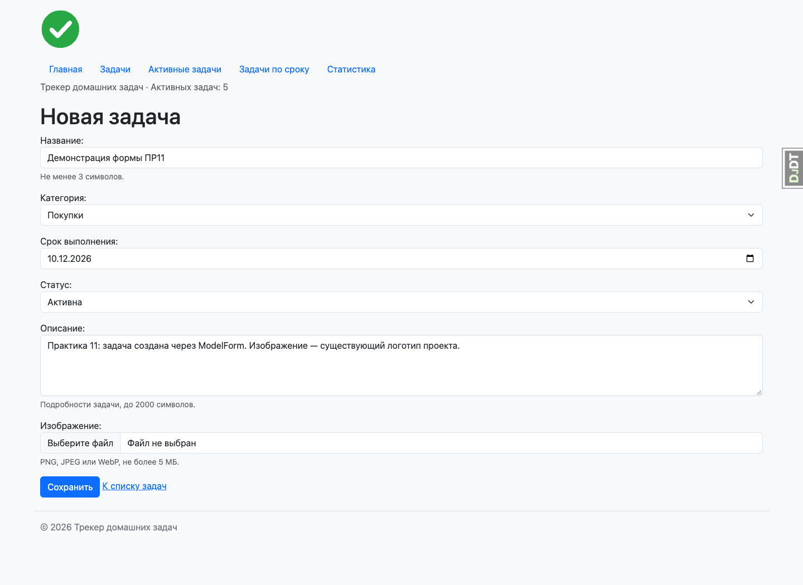
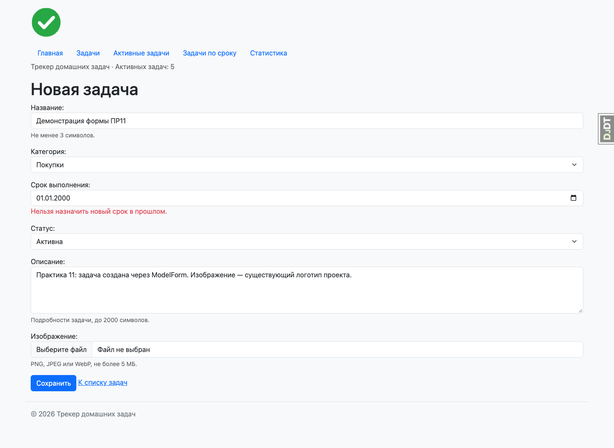
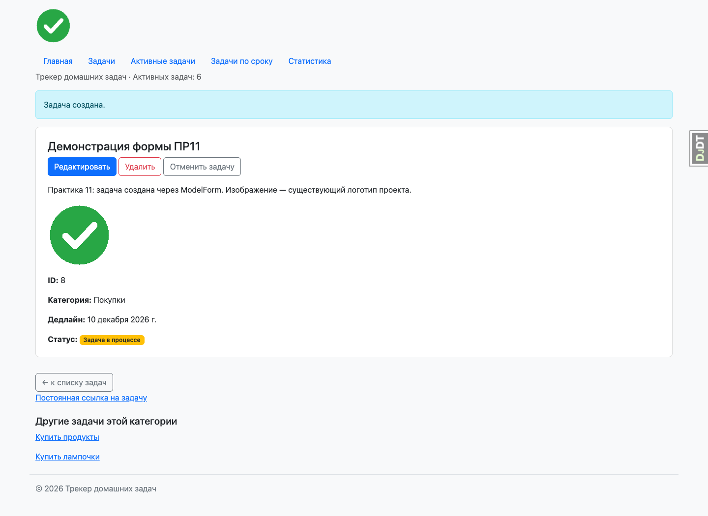
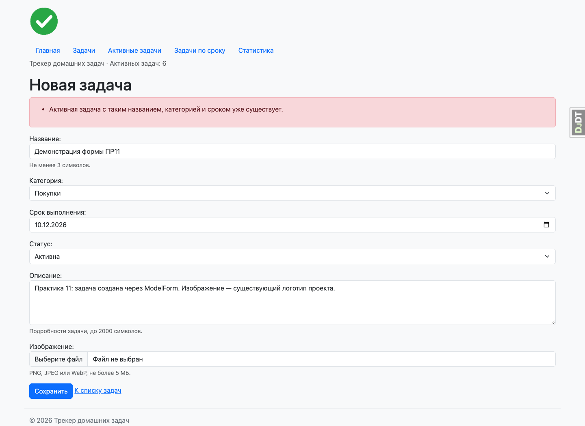
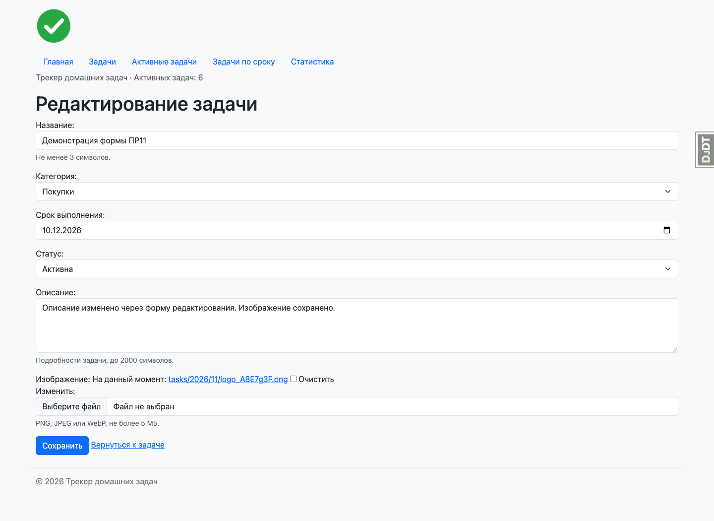
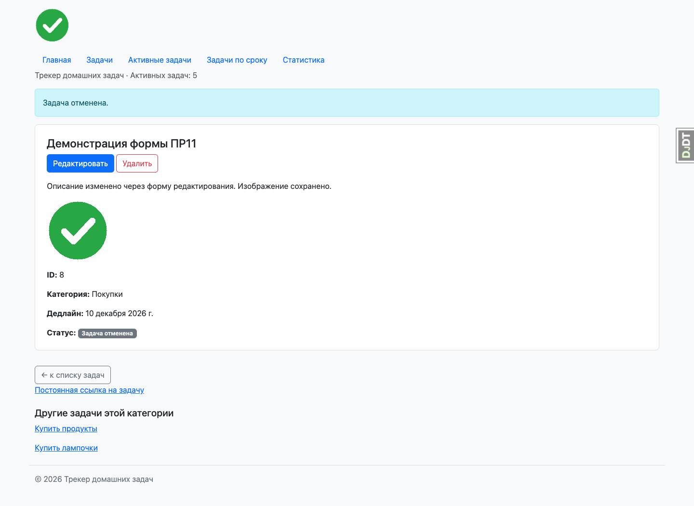
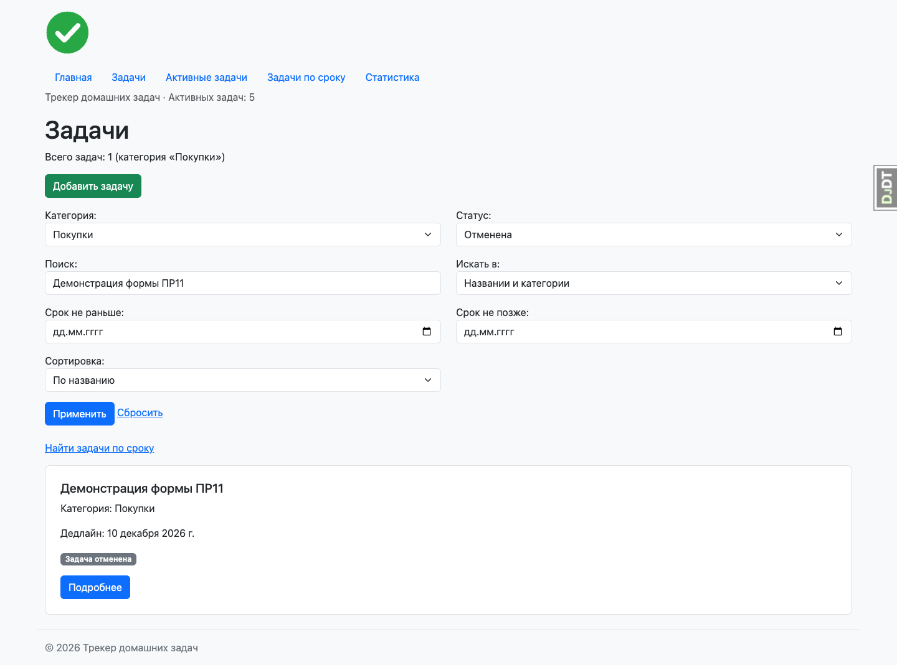
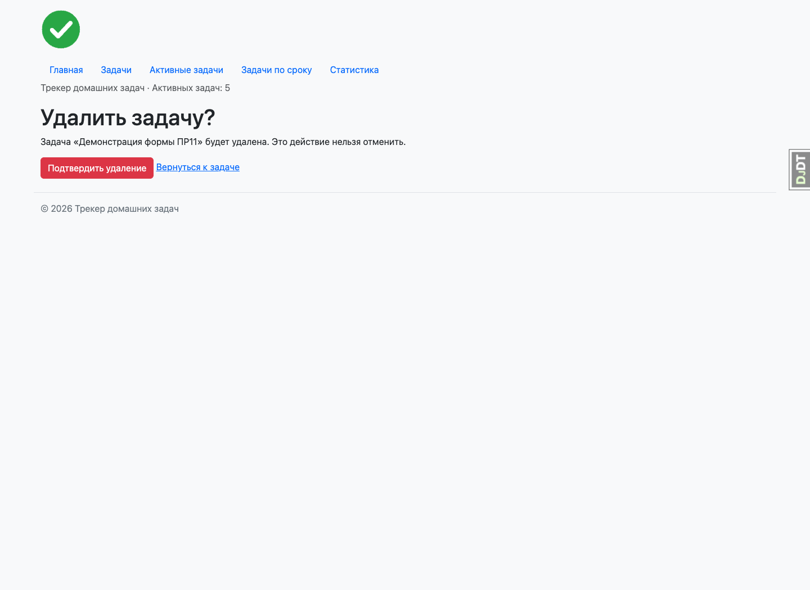
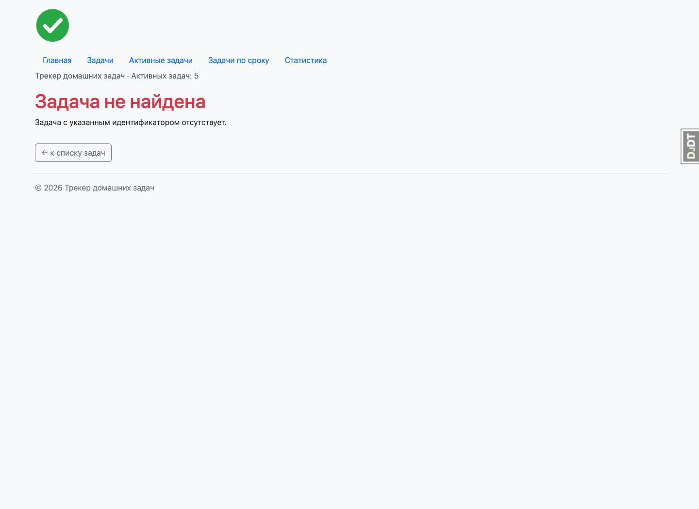

# Отчёт по практической работе № 11

| Поле | Значение |
|---|---|
| Образовательная организация | Указать перед сдачей |
| Дисциплина | Технологии разработки приложений на базе фреймворков |
| Тема | Формы в Django |
| Группа | ЭФБО-06-24 |
| Студент | Казанцев Егор |
| Вариант | Трекер домашних задач; номер варианта указать перед сдачей |
| Дата | 10.11.2026 |

## 1. Цель и материалы курса

Освоить Form и ModelForm, GET/POST-обработку, серверную валидацию, создание и редактирование объектов, CSRF-защиту и загрузку изображений. Применить формы к существующему трекеру домашних задач, сохранив ORM, маршруты, статусы и статистику.

Материалы Яндекс Практикума: спринт «Формы в Django», темы HTML-форм, Form, обработки данных, Bootstrap, ModelForm, CSRF, создания, редактирования, удаления, валидации и изображений. Прохождение курса не проверялось; перед сдачей требуется подтвердить фактически выполненные задания.

## 2. Созданные формы

В task_pages/forms.py реализованы TaskFilterForm и DueDateForm на основе forms.Form, а также TaskForm на основе ModelForm. Общий шаблон выводит подписи, виджеты, подсказки, ошибки полей и общие ошибки. Используются Bootstrap-классы, DateInput с type=date и Textarea для описания.

TaskFilterForm получает GET-параметры категории, статуса, поиска, диапазона сроков и сортировки. После is_valid() представление использует cleaned_data для ORM-фильтров. ModelChoiceField проверяет наличие категории. Неверная дата, выбор или порядок границ периода показывают ошибку и пустой список. Исторические даты в фильтре разрешены. Параметры сохраняются при пагинации.

TaskForm разрешает ввод только name, category, deadline, status, description и image. Служебные ID, slug и вычисляемый год срока пользователь менять через форму не может. Форма создания открывается по /tasks/create/, редактирования — /tasks/<id>/edit/.

## 3. Валидация и правила предметной области

clean_name() удаляет пробелы по краям и проверяет длину названия от 3 символов. clean_deadline() запрещает новый или изменённый срок в прошлом. Существующую просроченную задачу можно редактировать, сохраняя исходный срок, например при отметке выполнения.

TaskForm.clean() проверяет сочетание названия, категории, даты и активного статуса. Активный дубликат отклоняется с общей ошибкой; при редактировании сама запись исключается из проверки. Отменённые и выполненные записи не блокируют создание активной задачи. Разные задачи одной категории на одну дату допускаются. Это адаптация проверки доступности помещения из Roomly: сущности помещений в трекере отсутствуют.

Проверка дубликатов относится к пользовательской форме и не является ограничением уникальности БД; конкурентные запросы и прямые записи через ORM могут обойти её. Админка сохраняет собственную форму. Разграничение доступа по владельцам в этой учебной практике не реализовывалось.

## 4. Создание, редактирование, отмена и удаление

GET отображает форму, POST связывает её с request.POST и request.FILES. Сохранение выполняется только после is_valid(). Ошибки возвращаются вместе с введёнными значениями. Пустой POST также проходит проверку как связанная форма. После успешного сохранения выполняется redirect на карточку, поэтому обновление страницы результата не создаёт новую запись.

При редактировании используется instance: сохраняются ID, slug и связи объекта. Отмена доступна только через POST и переводит ACTIVE в CANCELLED; выполненная задача не отменяется. Отменённая запись остаётся в базе и исключается из активных задач и поиска по сроку. GET удаления показывает подтверждение, POST удаляет объект. Все изменяющие формы содержат CSRF-токен; отсутствующие объекты дают 404.

## 5. Изображения и изменение модели

Миграция 0003_task_description_task_image добавляет необязательные поля description и image. Перед применением сохранена локальная резервная копия базы. Существующие 6 задач и 3 категории сохранены.

Установлена Pillow 13.0.0. ImageField сохраняет путь к файлу; изображения размещаются в media/tasks/<год>/<месяц>/. Настроены MEDIA_ROOT, MEDIA_URL и раздача медиа в DEBUG. Форма использует multipart/form-data. Проверяются содержимое, формат PNG/JPEG/WebP и ограничение 5 МБ. Карточка показывает изображение либо сообщение об его отсутствии. Изображение сохраняется при редактировании без новой загрузки; доступна очистка ссылки на него. Прежние файлы автоматически не удаляются из хранилища, как предусмотрено стандартным поведением Django.

## 6. Проверка

- python manage.py check — ошибок нет.
- python manage.py makemigrations --check --dry-run — изменений нет.
- python manage.py showmigrations — миграции 0001–0003 применены.
- pytest -v — 84 теста и 6 подпроверок прошли.
- flake8 . --extend-exclude=venv и git diff --check — замечаний нет.

Автотесты проверяют корректный ввод и ошибки, обязательные поля, дубликаты, исключение текущего объекта, даты, диапазон фильтра, редактирование, отмену, подтверждение удаления, 404, запрет POST без CSRF, загрузку и очистку изображения, отклонение поддельного/неподдерживаемого/слишком большого файла, экранирование описания. Сценарии ПР9 и ПР10 продолжают проходить. Тесты используют отдельную БД и временный медиакаталог.

В Chrome через Playwright выполнен полный пользовательский цикл: заполнение формы, ошибка прошедшей даты, создание задачи с изображением, ошибка активного дубликата, редактирование, отмена, фильтрация отменённой задачи и удаление с подтверждением. В качестве изображения использован существующий логотип проекта. Демонстрационная задача удалена после проверки. Скриншоты реального интерфейса приведены в приложении; протокол тестов — pr11/tests.txt, состояние миграций — pr11/migrations.txt.

## 7. Git и вывод

Репозиторий: https://github.com/KazantsevEgor/home_task_tracker, ветка main. Коммит реализации: a13bd25 — «PR11: формы задач, валидация и загрузка изображений». Отчёт и скриншоты сохраняются отдельным коммитом.

В трекер интегрированы формы фильтрации, создания и редактирования, серверная валидация и обработка ошибок. Изменяющие операции выполняются через POST с CSRF-защитой. Добавлена загрузка изображений, сохранены прежние сценарии и обновлена документация проекта.

## Приложение. Скриншоты

